# Задание 1
### Часть 1  
Вывод первоначальной строки:  
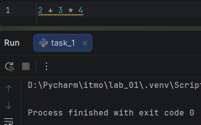  
Вывод исправленной строки:  
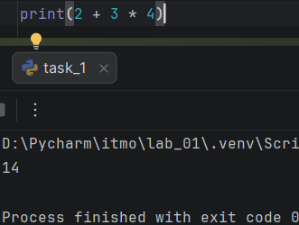  
В REPL выражение считывается, вычисляется и сразу выводится, так как это принцип устройства REPL, а при запуске файла мы только вычисляем значение выражения, но не передаём инструкции по выводу значения.  
### Часть 2  
Выражения:
```
"Python"

4 * 2

f"{course}: {hours} часов"
```  

Инструкции:
```
course = "Python"

hours = 4 * 2

print(f"{course}: {hours} часов")
```

Литералы:
```
"Python" - строковый литерал

4, 2 - целочисленные литералы
```  
  
Создаются имена:
- course
- hours
  
### Часть 3
Версия: Python 3.14.7  

Присваивание:
```
Assign(
         targets=[
            Name(id='course', ctx=Store())],
         value=Constant(value='Python')),
Assign(
         targets=[
            Name(id='hours', ctx=Store())],
         value=BinOp(
            left=Constant(value=4),
            op=Mult(),
            right=Constant(value=2)))
```  
  
Арифметическая операция:
```
BinOp(
         left=Constant(value=4),
         op=Mult(),
         right=Constant(value=2)))
```  

Вызов print():
```
Expr(
         value=Call(
            func=Name(id='print', ctx=Load()),
            args=[
               JoinedStr(
                  values=[
                     FormattedValue(
                        value=Name(id='course', ctx=Load()),
                        conversion=-1),
                     Constant(value=': '),
                     FormattedValue(
                        value=Name(id='hours', ctx=Load()),
                        conversion=-1),
                     Constant(value=' часов')])]))]
```  

Загрузка константы в дизассемблированном коде:
```
LOAD_CONST               1 ('Python')

LOAD_SMALL_INT          14

LOAD_SMALL_INT           8

LOAD_CONST               2 (': ')

LOAD_CONST               3 (' часов')

LOAD_CONST               4 (None)
```  
  
Вызов функции в дизассемблированном коде:
```
1           LOAD_NAME                0 (print)
            PUSH_NULL

# загружаем функцию 

CALL                     1
POP_TOP

# вызываем функцию
```  
### Контрольный вопрос  
Байткод CPython нельзя считать машинным кодом процессора, так как он выполняется виртуальной машиной Python, являясь некой абстракцией, в то время как ВМ уже переводит байткод в машинный код для каждой отдельной платформы (Windows, Linux, MacOS).  

# Задание 2

```
print("a == b:", a == b)
Ожидаемый результат: True
Фактический результат: True

print("a is b:", a is b)
Ожидаемый результат: True
Фактический результат: True

print("a == c:", a == c)
Ожидаемый результат: True
Фактический результат: True

print("a is c:", a is c)
Ожидаемый результат: False
Фактический результат: False
```  

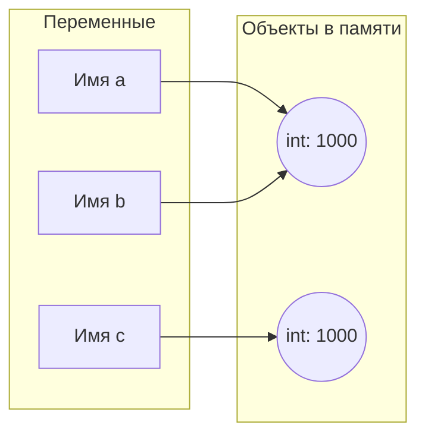

a и b ссылаются на один и тот же объект 1000, в то время как c ссылается уже на другую 1000.  

Оператор "==" проверяет равенство значений объектов, на которые ссылается переменная  
Оператор "is" проверяет, чтобы две переменные ссылались на один и тот же объект в памяти  

Исходный код:  
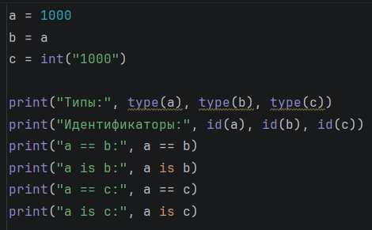  
Изменённый код с выводом:  
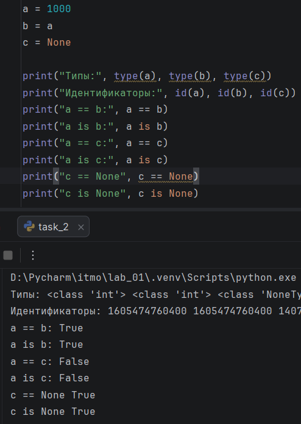  

Отдельный фрагмент:  
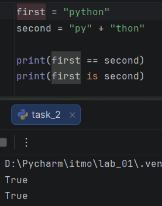  

Код вернул True в первом случае, так как итоговые значения оказались равны: "python" == "python".

Код вернул True во втором случае, так как CPython оптимизирует распределение памяти. В первой строке создаётся переменная first, в памяти появляется значение "python". Во второй строке создаётся новая переменная second, которая тоже должна ссылаться на значение "python". Чтобы не забивать память одинаковыми значениями, CPython объединяет значения, поэтому получается, что обе переменные ссылаются на один и тот же объект в памяти.  

Правило:  
> "==" используется для сравнения значений переменных  
> "is" используется для проверки, ссылаются ли переменные на один и тот же объект в памяти  
  
### Контрольные вопросы:  
1. Данная инструкция:
```
b = a
```  
НЕ создаёт копию объекта, а лишь делает так, чтобы они ссылались на одно значение в памяти  
2. 
```
type()   
```
Возвращает тип данных, которым является объект  
```  
id()
```
Возвращает уникальный идентификатор объекта, создаваемый на основе адреса в оперативной памяти  

# Задание 3
### Эксперимент А  
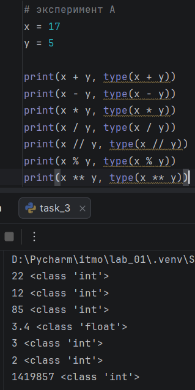  
// - выполняет целочисленное деление, отбрасывая дробную часть  
/ - выполняет деление в привычном его понимание, сохраняя дробную часть  

### Эксперимент B  
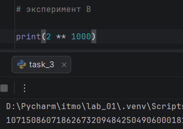  
Python имеет функцию динамического выделения памяти для целых чисел, разбивая большие числа на цифровые блоки и по мере необходимости выделяя для них необходимую память. Таким образом, в Python не может возникнуть ошибки переполнения, как, например, в C++  

### Эксперимент C  
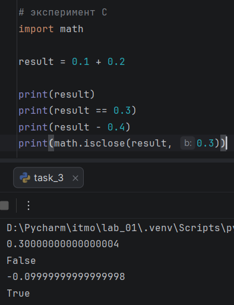  
В двоичном представлении невозможно точно записать дробную часть, если она не кратна 2, поэтому используется максимальное приближенное значение. По этой причине возникает очень маленькие погрешности при работе с числами с плавающей запятой, которые могут повлиять на результат работы. Поэтому сравнение суммы, которая имеет большую погрешность, накопленную от двух слагаемых, с константой, которая практически не имеет погрешности, приводит к False. По этой же причине и разность с константой будет неиадельной.  
Правило:  
> Числа с плавающей запятой ни в коем случае нельзя сравнивать с помощью общепринятого оператора сравнения, необходимо использовать специальные инструменты, например, math.isclose(), которые учитывают погрешности хранения чисел с плавающей точкой в двоичной системе.  

### эксперимент D  
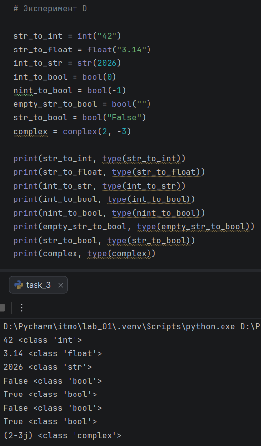  
```python
bool("False")
```  
Возвращает истинное значение, так как bool() проверяет, пустая ли строка, если да, то возвращает False, если строка не пустая, то функция возвращает True. Так как в нашем случае строка не пустая (в неё записано "False") функция вернула истинное значение  

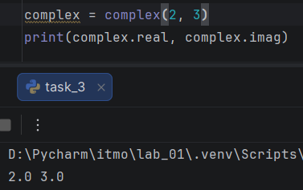  
Действительная и мнимая части комплексного числа  

### Контрольные вопросы:
1. Деление (не целочисленное) возвращает float, так как Python спроектирован так, чтобы математическое деление выдавало предсказуемый тип данных (float), чтобы не было проблем с дальнейшей обработкой данных  
2. В первом случае python преобразует строку, а во втором "отсекает" дробную часть от float
3. Ложные значения возвращают:
- bool(0)
- bool("")

# Задание 4  
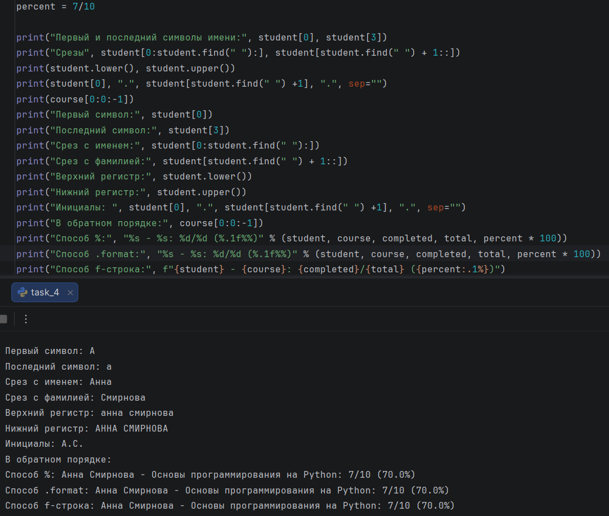  


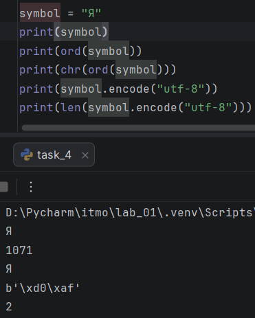  


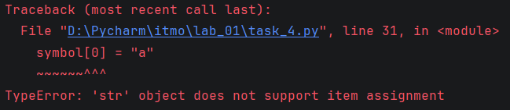  
Сообщение об ошибке после попытки изменить символ в строке

### Контрольные вопросы:
1. len(symbol) возвращает количество символом в строке, в то время как len(symbol.encode("utf-8")) возвращает количество байт, которыми закодирован символ
2. start - индекс элемента, с которого начинается срез; end - индекс элемента, которым заканчивается срез !сам в срез не включается!; step - шаг выборки
3. Методы по типу .upper() не изменяют исходную строку, а создают её копию  

# Задание 5  
### Анализ  
1. Имя - тип объекта:
- person_name -> str
- exp_name -> str
- amount_starts -> int
- len_of_one -> float
- complex_coef1 -> float
- complex_coef2 -> float
- sum_len_sec -> float
- sum_len_min -> float
- complex_coef -> complex
- square_coef -> float
- has_runs -> bool

2. Разбор строки №12:
```sum_len_sec = amount_starts * len_of_one```  
- имена: sum_len_sec, amount_starts, len_of_ine
- операторы: =, *
- литералов нет
- вызовов функций нет

3. Путь программы:
- интерпретатор Python считывает файл
- код разбивается на ключевые слова, имена, операторы, литералы
- строится абстрактное синтаксическое дерево (AST)
- AST транслируется в байт-код для каждой платформы
- виртуальная машина выполняет байт-код, переводя его в инструкции для процессора

4. input() всегда возвращает строку. Арифметические действия возможны лишь с int или float, поэтому необходимо явно их преобразовать, иначе будет ошибка TypeError

### Контрольный вопрос:  
Так как переменные - ссылки на объекты в памяти, то после повторного присваивания теряется ссылка на предыдущий объект (его вскоре уберёт встроенный сборщик мусора), а переменная получает ссылку на новый объект в памяти

# Вывод  
Неожиданные особенности Python:  
1. Интерпретатор Python для оптимизации не создаёт несколько одинаковых объектов в памяти, а делает единственный экземпляр, на который уже могут ссылаться разные переменные (Задание 2). За счёт данного приёма Python работает с большими данными намного эффективнее и с меньшими затратами по памяти.
2. Смысл проверки None через оператор is, а не обычным сравнением. Вся суть заключается в принципе устройства None, которые хранится в памяти в единственном экземпляре (пункт 1).
3. Устройство хранения огромных чисел - разделение на более маленькие числа, которые в памяти хранить проще