## Задание 1  
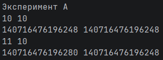  
Значение *b* не изменилось, так как целочисленный тип данных является неизменяемым типом данных, поэтому при прибавлении 1 к *a* создаётся совершенно новый объект в памяти, на который начинает ссылаться переменная.  
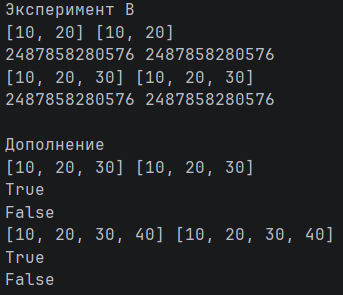  
До переназначения:
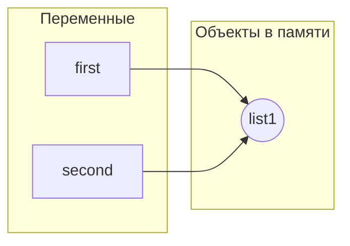
После:
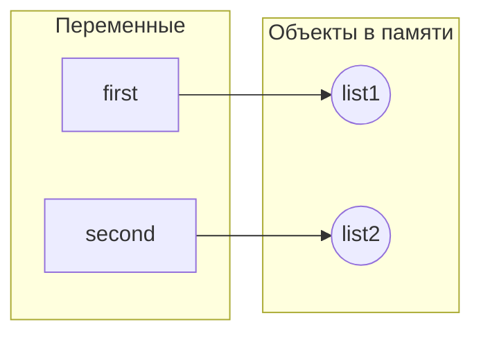
### Вопросы для анализа:
1. Операция присваивания не изменяет объект, а лишь создаёт новую ссылку на объект в памяти.
2. Потому что Python создаёт в памяти копию прошлого объекта, но уже с необходимыми изменениями, и связывает переменную уже с ним.
3. Сравнить их по id() или с помощью *is*.  

## Задание 2
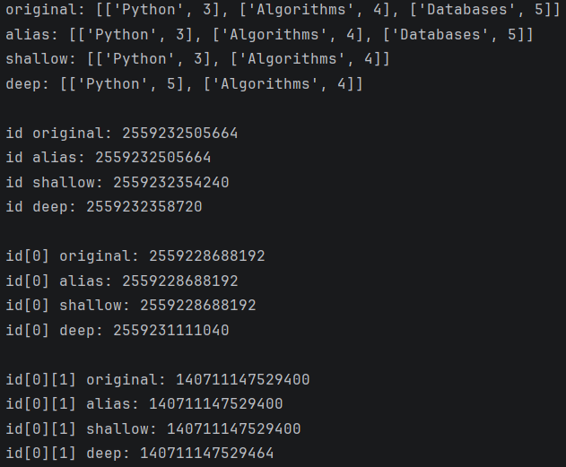  
Вывод программы

| Операция | Новый внешний объект | Новые вложенные объекты | Изменения независимы |
|---|---|---|---|
| Присваивание | Нет | Нет | Нет |
| Поверхностная копия | Да | Нет | Частично |
| Глубокая копия | Да | Да | Да |

Поверхностная копия позволяет свободно добавлять новые элементы в оригинальную структуру, однако изменения внутри уже существующих будут влиять на поверхностную копию.
### Исследование создания матрицы  
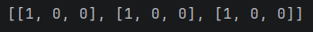  
Вывод неправильно созданной матрицы   
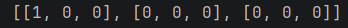  
Вывод правильно созданной матрицы  
*В первом случае мы создаём список из трёх нулей, а затем копируем ссылку на него, поэтому в массиве находится 1 уникальный список с 2 копиями. Во втором же случае каждый раз создаётся совершенно новый независимый список с нуля.*  
### Вопросы для анализа:
1. Поверхностная копия создаёт новую структуру, но копирует элементы внутри, в то время как глубокая копия создаёт новую структуру с независимыми элементами.
2. Глубокое копирование очень затратно по памяти и времени выполнения, также существует риск ошибки при попытке копирования объектов, которые принципиально не могут быть глубоко скопированы (например, сетевые сокеты или открытые файлы).
3. Поверхностной копии достаточно при работе с неизменяемыми структурами или не содержащими вложенных массивов.  

## Задание 3
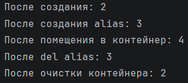  
Вывод программы  
  
- `sys.getrefcount()` показывает на одну ссылку больше, так как в процессе выполнения функции внутри создаётся ещё одна ссылка, которая также учитывается.
- увеличивают счётчик:
  - создание новой переменной
  - помещение в контейнер
  - передача объекта в функцию
- уменьшают счётчик:
  - удаление переменной
  - очистка контейнера
  - выход из области видимости функции
- Напрямую объект удаляет только сборщик мусора. Именно поэтому программисту, чтобы удалить объект, необходимо удалить все ссылки на него.  
Слабая ссылка не увеличивают счётчик ссылок на объект, таким образом не продлевая его время жизни.  
Явным примером полезности слабых ссылок является кэширование: в словаре-кэше тяжёлые объекты хранятся с помощью слабых ссылок, поэтому когда они перестают использоваться, кэш очищается.  
### Практическое задание  
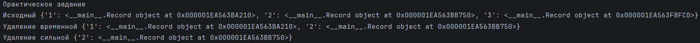  
Действительно оказалось, что слабый реестр никак не влияет на время жизни объекта  
### Вопросы для анализа:
1. Объект удаляется когда счётчик ссылок = 0.
2. При освобождении небольших объектов (до 512 байт) память остаётся зарезервированной виртуальной машиной. Возвращение памяти ОС происходит при освобождении особо крупных объёмов.
3. Сильная ссылка продлевает время жизни объекта, в то время как слабая - нет.  
## Задание 4
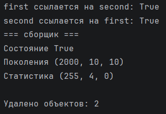  
Вывод программы  
4. Объекты ссылаются друг на друга, поэтому их счётчик ссылок всегда > 0, из-за чего механизм подсчёта ссылок не может их удалить.
5. Поколения сборщика мусора существуют для оптимизации производительности. Сканирование более старых объектов происходит реже, чем сканирование новых.  
### Практическое задание  
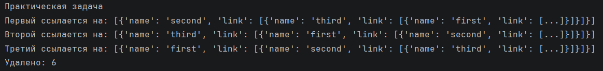  
Удалено 6 объектов, так как сборщик удалил как сами ноды, так и ссылки внутри нод.  
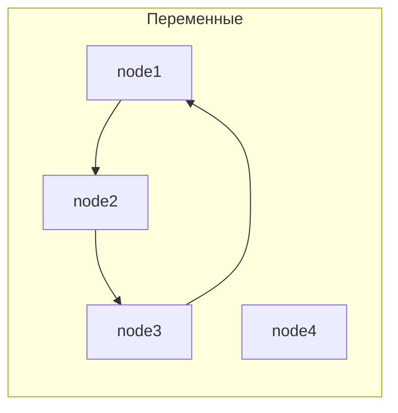
```python
node_1["link"].append(node_2)
node_2["link"].append(node_3)
node_3["link"].append(node_1)
``` 
После выполнения этого куска кода создаётся цикл (закольцовывание), так как объекты начинают хранить ссылки друг на другу
```python
del node_1
del node_2
del node_3
```
Здесь же мы обрываем все связи, уничтожая цикл  
### Вопросы для анализа:  
1. Циклическая ссылка возникает, когда объект начинает ссылаться сам на себя прямо или косвенно (как было в практическом задании).
2. Объект может быть недостижим из-за существования цикла, в котором объекты ссылаются друг на друга, а на них извне не ссылается никто другой.
3. Для оптимизации производительности.  

## Задание 5  
### Часть 1  
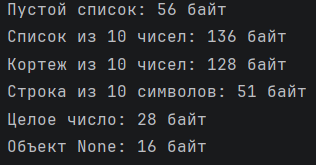  
Вывод программы  
*Контейнер хранит служебную информацию и ссылки на хранящиеся объекты, поэтому его размер меньше, чем если бы в нём хранились сами объекты.*  
### Часть 2  
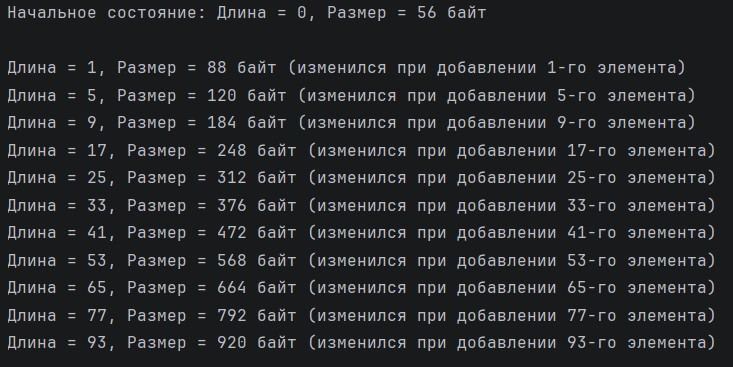  
Вывод программы
- Нет, размер списка НЕ увеличивается с каждым `append`.
- Резервирование памяти является очень дорогим действием, поэтому для уменьшения обращений к ОС python резервирует с определённым запасом.
- Длина списка показывает количество реальных элементов в нём, в то время как размер показывает количество памяти, затраченной всем список, вне зависимости от его заполненности.  
### Часть 3  
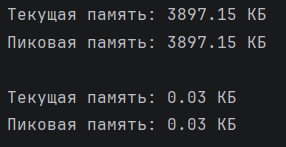  
Вывод программы  
*В первом случае создаётся материализованная последовательность, которая мгновенно занимает определённый объём памяти, в то время как во втором случае используется объект, хранящий правило получения значений (итератор), который начнёт занимать память только когда потребуются значения.*
### Рекомендации по оптимизации
1. Использование неизменяемых типов данных (часть 1), так как они занимают меньше места в памяти.
2. Выделение необходимого количества памяти (часть 2) для уменьшения количества запросов к ОС.
3. Использование итераторов, которые выдают значение при необходимости.
### Практическая задача
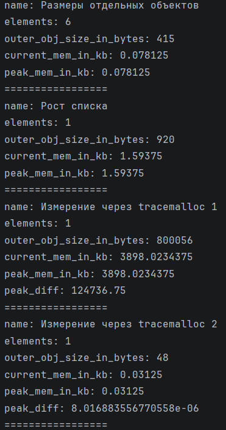  
Вывод программы