## Задание 1  
Таблица с ожидаемыми и фактическими результатами:  

| вход | ожидаемый выход | фактический выход |
| --- | --- | --- |
| 0 | недостаточный | недостаточный |
| 59 | неостаточный | недостаточный |
| 60 | удовлетворительный | удовлетворительный |
| 74 | удовлетворительный | удовлетворительный |
| 75 | хороший | хороший |
| 89 | хороший | хороший |
| 90 | отличный | отличный |
| 100 | отличный | отличный |

Программа отрабатывает полностью корректно с граничными входными данными.  
В самом начале идёт проверка корректности диапазона входных данных, далее идёт классификация уровня студента с помощью конструкции `match/case`, после этого определяется тип работы, где существует ветка с неизвестной работой, в которую программа никогда не попадёт, так как ещё в самом начале была проведена проверка на корректность ввода.  
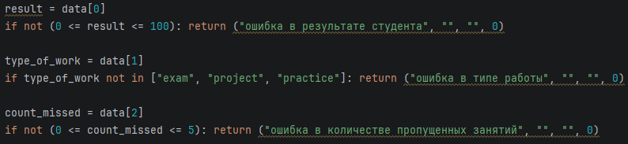  
Проверка корректности входных данных 
  
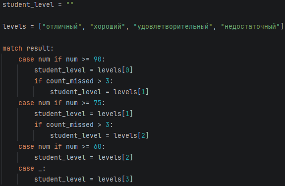  
Определение уровня студента  
  
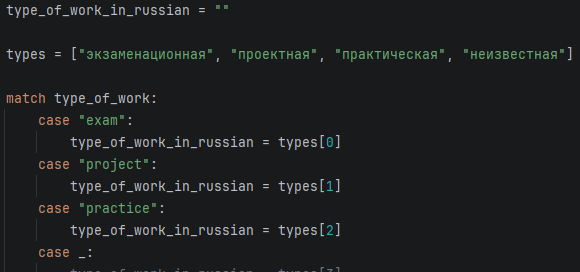  
Определение типа работы  
  
## Задание 2
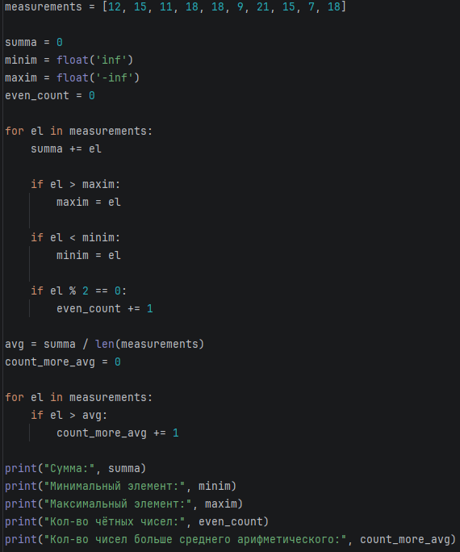  
Реализация встроенных функций python в одном проходе цикла for.  
  
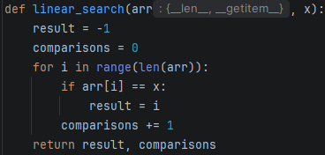  
Линейный поиск  
  
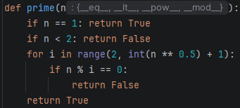  
Проверка числа на простоту  
- число операций зависит от исходного числа;
- память нужна только для хранения переменных n и i, поэтому память O(1);
- если у числа есть два различных множителя, то один из них точно находится до корня, а второй можно вычислить с помощью операции деления, в худшем случае множителями будет корень числа и поэтому они совпадут.  
  
Таблица затрат по времени и по памяти

| алгоритм | время | память |
| --- | --- | --- |
| линейный поиск | n | 1 |
| простое число | &radic;n | 1 |
| сортировка выбором | n2 | 1 |
| бинарный поиск | log n | 1 |

Таблица количества операций на одинаковых массивах

| алгоритм | количество сравнений |
| --- | --- |
| линейный поиск 10 | 10 |
| линейный поиск 100 | 100 |
| линейный поиск 1000 | 1000 |
| бинарный поиск 10 | 2 |
| бинарный поиск 100 | 3 |
| бинарный поиск 1000 | 6 |

## Задание 3
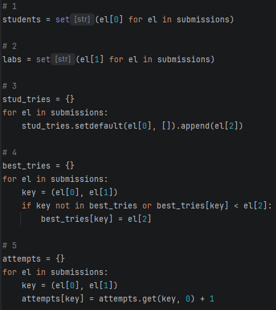  
Создание новых словарей по заданию  
  
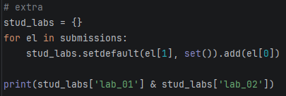  
Использование операции пересечения над множеством  
  
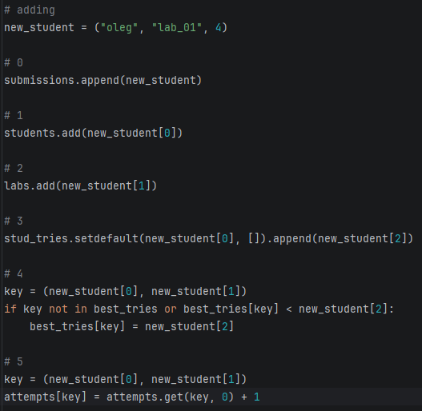  
Добавление новой записи без полного повторения построения  
  
### Ответы на вопросы
- множество подходит для хранения уникальных элементов, так как в этом и заключается принципиальное отличие множества от других структур данных - хранения только УНИКАЛЬНЫХ объектов;
- кортеж можно использовать как ключ словаря, так как он является неизменяемой структурой данных;
- список нельзя использовать как ключ словаря, так как он является изменяемым;
- если ключ составной, то список будет использовать линейный поиск, в то время как словарь сразу обратить по ключу за O(1).

Оценка сложности коллекций

| коллекция | добавление | поиск |
| --- | --- | --- |
| list | O(1) | O(1) по индексу и O(n) по значению |
| dict | O(1) | O(1) |
| set | O(1) | O(1) |
| tuple | --- | O(1) |

### Практическое расширение  
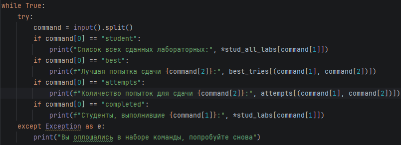  
Реализация текстовых запросов

## Задание 4
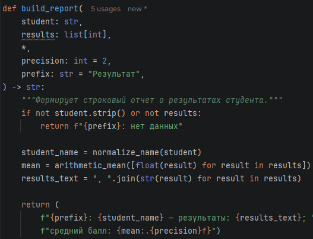  
Реализация одной из функций  
  
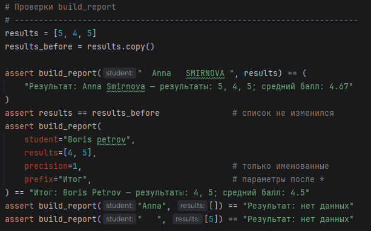  
Тесты для этой функции  
  
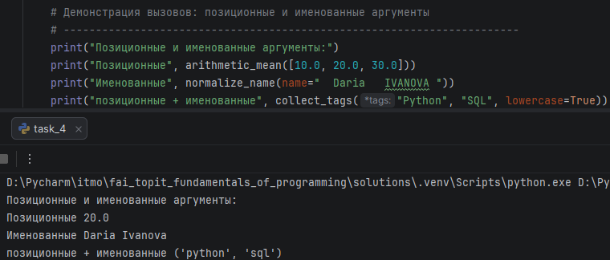  
Работа с позиционными и именованными аргументами  
  
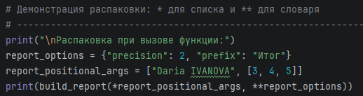  
Распаковка списка и словаря  

### Исследование LEGB
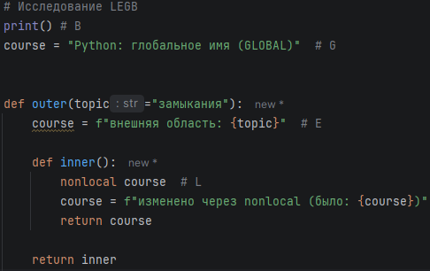  
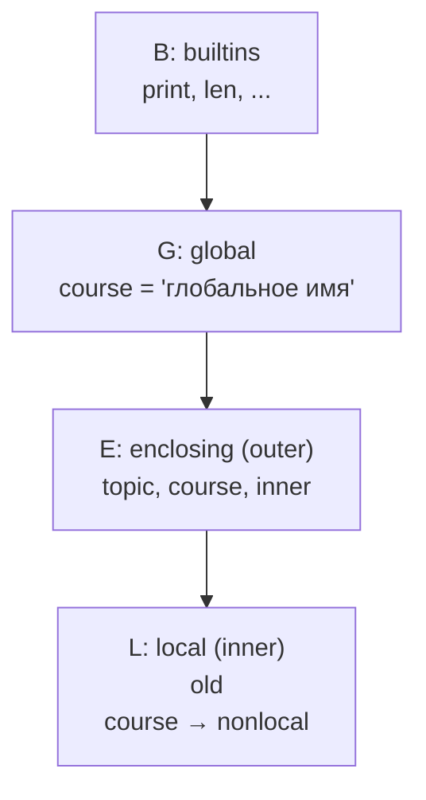
*Правило: интерпретатор ищет имя L → E → G → B (Local, Enclosing, Global, Builtin) и берёт
первое совпадение. Компилятор решает, к какой области отнести имя, ещё до выполнения — по факту присваивания в функции.*

### Ошибка изменяемого значения по умолчанию
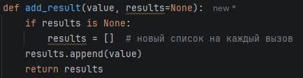  
Исправленный вариант  

Значение по умолчанию вычисляется один раз, поэтому при каждом вызове функции мы не создаём новый список, а работаем со старым. Поэтому для реализации подобных идей необходимо создавать список внутри функции, а не как значение по умолчанию.
  
### Практическое расширение
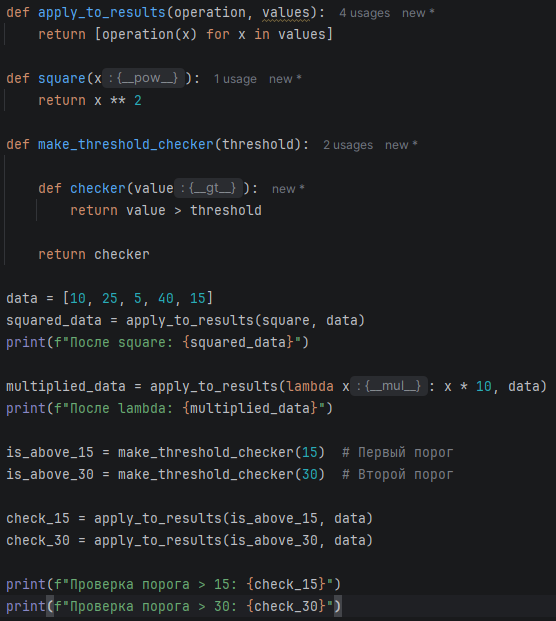  
Решение задания  

В замыкании сохраняется значение threshold. При каждом новом вызове мы передаём новое значение, следовательно, образуется новое замыкание с новым значением.

## Задание 5  
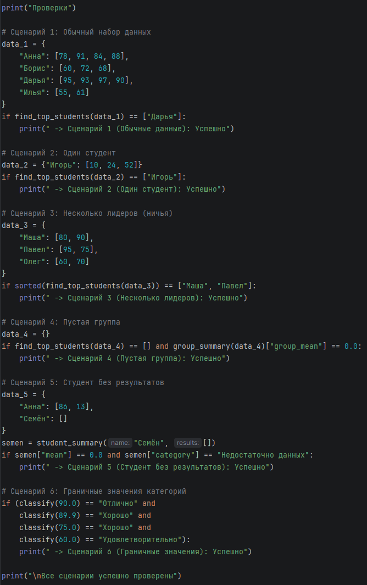  
Тестирование  
  
Контракты:  
- mean(values)
  - Допустимые входные данные: Список (list) целых (int) или вещественных (float) чисел;
  - Результат: Число типа float;
  - Особые случаи: Если передан пустой список [], функция возвращает 0.0, предотвращая критическую ошибку деления на ноль (ZeroDivisionError).

- minimum(values) / maximum(values)

  - Допустимые входные данные: Список (list) целых или вещественных чисел;
  - Результат: Одиночное число (int или float);
  - Особые случаи: Если список пуст, функции возвращают 0. Поиск выполняется вручную через цикл (без использования min() / max()), что удовлетворяет ограничениям ТЗ.

- classify(score)

  - Допустимые входные данные: Вещественное число float (средний балл);
  - Результат: Строковое значение (str) с названием категории успеваемости;
  - Особые случаи: При score == 0.0 (признак отсутствия оценок) возвращает защитную категорию "Недостаточно данных". Все переходы (60, 75, 90) обрабатываются нестрогими неравенствами >= для точного включения граничных баллов.

- student_summary(name, results)

  - Допустимые входные данные: Строка name (имя) и список целых чисел results (оценки);
  - Результат: Словарь dict с ключами name, mean, min, max, category;
  - Особые случаи: Корректно перенаправляет пустые списки оценок в атомарные функции, формируя безопасный «нулевой» профиль студента.

- group_summary(students_data)

  - Допустимые входные данные: Словарь dict, где ключ — имя (str), а значение — список оценок (list[int]);
  - Результат: Словарь dict с общим средним баллом группы и счетчиком категорий;
  - Особые случаи: Если группа пуста ({}), возвращается структура {"group_mean": 0.0, "categories_count": {}}, не вызывая падения программы.

- find_top_students(students_data)

  - Допустимые входные данные: Словарь вида {Имя: [Оценки]};
  - Результат: Список строк list[str] с именами лидеров;
  - Особые случаи: Если высший средний балл совпадает у нескольких студентов (ситуация «ничьей»), функция вернет список со всеми лидерами. При пустой группе возвращает пустой список [].

Программа состоит из самых базовых математических функций, затем идут промежуточные агрегирующие функции, далее идёт реализация красивого вывода для пользователя.  
  
Пусть имеется n студентов, а m - максимальное количество оценок у студента. Тогда сложность алгоритма O(n2 + n * m) - сортировка выбором + проходы циклом for для вычисления минимумов/максимумов.