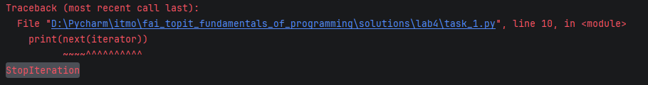
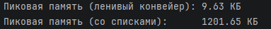
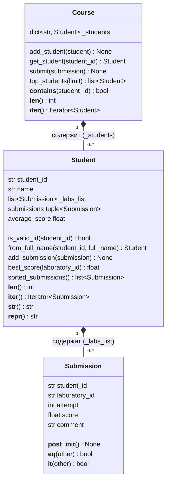

## Задание 1  
  
При следующем `next` выскакивает ошибка  

```python
def consume(iterable) -> list:
    result = []
    iterable = iter(iterable)
    try:
        while iterable:
            result.append(next(iterable))
    except StopIteration:
        return result
```  
Реализация функции `consume`

### Практическое расширение

```python
def my_enumerate(iterable, start=0):
    idx = start
    for elem in iterable:
        yield idx, elem
        idx += 1

def my_zip(first, second):
    first = iter(first)
    second = iter(second)
    while True:
        try:
            yield next(first), next(second)
        except StopIteration:
            break
```

### Вопросы для анализа  
1. Итератор по итерируемому объекту
2. Вызывать ошибка `StopIteration`
3. Так как итератор уже является итератором
  
## Задание 2
```python
class StepRangeIterator:
    def __init__(self, start, stop, step):
        self.start = start
        self.stop = stop
        self.step = step

    def __next__(self):
        if (self.start <= self.stop and self.step < 0) or \
           (self.stop <= self.start and self.step > 0):
            raise StopIteration
        else:
            value = self.start
            self.start += self.step
            return value


class StepRange:
    def __init__(self, start, stop, step):
        self.start = start
        self.stop = stop
        self.step = step

    def __iter__(self):
        return StepRangeIterator(self.start, self.stop, self.step)
```  
Реализация программы  
  
Диапазон StepRange(2, 11, 3) -> последовательность: [ 2, 5, 8 ]  
  
1. Инициализация: it1 = iter(r), it2 = iter(r)  
   it1.current = 2 ->  [ 2, 5, 8 ]  
   it2.current = 2 ->  [ 2, 5, 8 ]  
  
2. Вызов next (it1) -> вернул 2 (it1 сдвинулся на +3)  
   it1.current = 5        [ 2, >5<, 8 ]  
   it2.current = 2        [>2<, 5, 8 ]  

3. Вызов next (it2) -> вернул 2 (it2 сдвинулся на +3)  
   it1.current = 5        [ 2, >5<, 8 ]  
   it2.current = 5        [ 2, >5<, 8 ]    
  
4. Вызов next (it1) -> вернул 5 (it1 сдвинулся на +3)  
   it1.current = 8        [ 2, 5, >8<]  
   it2.current = 5        [ 2, >5<, 8 ]  
  
5. Вызов next (it1) -> вернул 8 (it1 дошел до stop=11, следующий вызов даст StopIteration)  
   it1.current = 11       [ 2, 5, 8 ] (исчерпан)  
   it2.current = 5        [ 2, >5<, 8 ]  
   
6. Вызов next (it2) -> вернул 5 (it2 продолжает обход независимо от it1)  
   it1.current = 11       [ 2, 5, 8 ] (исчерпан)  
   it2.current = 8        [ 2, 5, >8<]  

### Практическое расширение 

```python
def __len__(self):
    return abs(self.stop - self.start) // abs(self.step)

def __contains__(self, value):
    between = self.start <= value <= self.stop or self.stop <= value <= self.step
    return between and abs(between - self.start) % abs(self.step) == 0

def __repr__(self):
    return f"StepRange({self.start}, {self.stop}, {self.step})"
```
  
### Вопросы для анализа  
1. Чтобы при создании двух параллельных генераторов не было пересечений
2. Генератор выполнит один проход и упрётся в `StopIteration`
3. O(1)

## Задание 3
```python
def read_measurenets(lines):
    for line in lines:
        if line == "":
            continue
        yield float(line.strip())

def filter_range(values, minimum:float, maximum:float):
    for value in values:
        if minimum <= value <= maximum:
            yield value

def moving_average(values, window_size: int):
    if window_size <= 0: raise ValueError("window_size must be > 0")

    # окном является дека
    window = deque(maxlen=window_size)
    current_sum = 0.0

    for value in values:
        if len(window) == window_size:
            current_sum -= window[0]
        window.append(value)
        current_sum += value

        if len(window) == window_size:
            yield current_sum / window_size
```  
Реализация программы  

Включение сохраняет сразу все элементы в памяти, при этом доступ к конкретному элементу может достигать O(1), в то время как генератор вычисляет элементы по необходимости, но чтобы получить конкретный элемент, до него нужно долго идти

### Практическое расширение  
  
Сравнение памяти

## Задание 4
1.

2. Композицией представлена "связь" между классами. `Student` содержит `Submission`, `Course` содержит `Student`
3. Совершенно разные логические объекты, совершенно разные методы, связь одного с другим
4. В `Submission` реализована проверка student_id, laboratory_id, score; в `Student` реализована проверка заполнения с помощью полного имени, а также идёт проверка самих работ; в `Course` реализована проверка на уникальность student_id
5. 
```python
course = Course()

st1 = Student.from_full_name("st_01", "Иванов Иван")
st2 = Student.from_full_name("st_02", "Петрова Анна")

course.add_student(st1)
course.add_student(st2)

course.submit(Submission("st_01", "lab_1", 1, 85.0))
course.submit(Submission("st_01", "lab_2", 1, 95.0))

print(len(course))  # количество студентов на курсе
print(len(st1))     # количество сданных работ у студента st1

print("st_01" in course)  # срабатывает __contains__ у Course
print("st_99" in course)

for student in course:          # вызывает iter(course) -> обход объектов Student
    print(student.name)
    for sub in student:         # вызывает iter(student) -> обход объектов Submission
        print(f"  {sub.laboratory_id}: {sub.score}")

```

## Задание 5  
| механизм | смысл | плюсы | минусы |
| --- | --- | --- | --- |
| Наследование | Подкласс перенимает интерфейс и поведение базового класса. | Устраняет дублирование кода, гарантирует единый контракт для полиморфизма. | Жёсткая связанность классов, риск нарушения иерархии при сложных изменениях. |
| Композиция | Объект включает в себя другие объекты и делегирует им работу. | Гибкость, сокрытие внутренней структуры данных, лёгкая замена компонентов. | Требуется вручную прописывать методы-обёртки для делегирования. |
| Протоколы Python | Поддержание работтоспособности встроенных функций языка | Максимальная интеграция со встроенными функциями Python (for, sum, max, len) без жёсткой привязки к базовому классу. | Ошибки несоответствия интерфейса проявляются только во время выполнения программы. |


1. Наследование (CourseEvent -> SubmissionEvent, AttendanceEvent, CommentEvent). Использовано для моделирования разновидностей событий курса. Все наследники разделяют общее поле времени создания created_at и обязаны реализовать абстрактное свойство student_id и метод describe(), что позволяет функции render_timeline() обрабатывать их полиморфно без проверки типов.
2. Композиция (CourseJournal содержит list[CourseEvent], ScoreView хранит ссылку на источник событий). Журнал не наследуется от встроенного list, а инкапсулирует список _events внутри себя. Это защищает журнал от прямого изменения данных извне и позволяет возвращать безопасную сводку в summary(). В ScoreView композиция позволяет фильтровать поток событий без копирования данных.
3. Протоколы Python (__len__, __iter__, __getitem__). Реализованы в CourseJournal и ScoreView для поддержки стандартных операций языка. Благодаря протоколу итератора (__iter__) объект ScoreView можно напрямую передавать в функции sum(), max(), min() и list(), а метод __getitem__ обеспечивает поддержку индексации и срезов в журнале.

### Практическое расширение
```python
class DeadlineEvent(CourseEvent, ABC):
    def __init__(self, student_id, deadline):
        super().__init__(student_id, deadline)
        self.deadline = deadline

    @property
    def student_id(self):
        return self._student_id

    def describe(self):
        return (
            f"=== Дедлайн {self.deadline:%Y-%m-%d %H:%M}!!! ==="
        )
```